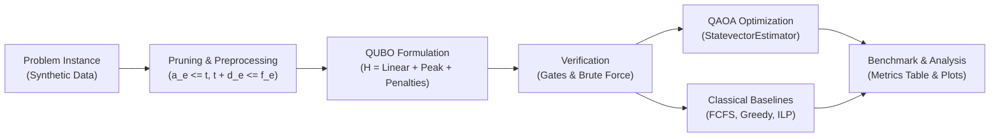

# EV Charging Scheduling with QUBO and QAOA

**Quantum Hack Day Kochi | Qiskit Fall Fest 2026 | Track 4**

---

## 1. Project Overview

This project schedules Electric Vehicle (EV) charging across distributed charging stations. The goal is to minimize total energy cost, travel distance, waiting delay, and grid peak load while respecting station bay capacity and EV charging deadlines.

> [!NOTE]
> All vehicle, station, and load profile data in this project is synthetic.

---

## 2. Solution Pipeline



---

## 3. Mathematical Formulation

### 3.1 Decision Variables
Let binary variable $x_v \in \{0, 1\}$ represent variable $v = (e, s, t)$ in pruned set $V$:
- $e$: EV index
- $s$: Charging station index
- $t$: Slot index when charging starts

If $x_{(e, s, t)} = 1$, vehicle $e$ starts charging at station $s$ at time slot $t$. Charging continues for fixed duration $d_e$ slots.

Active charging slots for $(e, t)$ are:
$$I(e, t) = \{ t, t+1, \dots, t + d_e - 1 \}$$

### 3.2 Linear Costs (E1)
Each variable $v = (e, s, t)$ has an individual linear cost:
$$c_v = \underbrace{p_e \sum_{\tau \in I(e, t)} \pi_\tau}_{\text{Energy Cost}} + \underbrace{\kappa \cdot \text{dist}(e, s)}_{\text{Travel Cost}} + \underbrace{\omega \cdot (t - a_e)}_{\text{Waiting Cost}}$$

Where:
- $\pi_\tau$: Electricity price per kWh at time slot $\tau$
- $p_e$: Average power per active slot in kW ($p_e = E_e / d_e$)
- $\kappa$: Travel weight (\$0.30 per km)
- $\omega$: Waiting delay weight (\$0.50 per slot)

### 3.3 Grid Load Profile (E2)
Total grid load at time slot $\tau$ is:
$$L_\tau(x) = \sum_{v : \tau \in I(v)} p_{e(v)} \cdot x_v$$

Peak minimization uses a quadratic proxy $\mu \sum_\tau L_\tau(x)^2$, where $\mu = 0.01$.

### 3.4 Full Objective Function
The QUBO minimizes Hamiltonian $H(x)$:
$$H(x) = \sum_v c_v x_v + \mu \sum_\tau L_\tau(x)^2 + \lambda_A \sum_e \left(\sum_{v \in V_e} x_v - 1\right)^2 + \lambda_O \sum_{(u, v) \in C} x_u x_v$$

- **Constraint E3 (Assignment):** Each vehicle charges exactly once.
- **Constraint E4 (Overlap):** At most one vehicle occupies a bay at any slot ($C$ is the set of conflicting pairs on the same station).

### 3.5 Penalty Weight Selection ($\lambda$)
To prevent constraint violations from being profitable, penalty weights $\lambda_A$ and $\lambda_O$ are set based on the maximum cost reduction from dropping an EV:
$$\Lambda = \max_v \left[ c_v + \mu \cdot d_e \cdot p_e \cdot \left( p_e + 2 \sum_{e' \neq e} p_{e'} \right) \right]$$
Default value: $\lambda_A = \lambda_O = 1.1 \cdot \Lambda$.

---

## 4. Design Rationale: Why This Approach?

### 4.1 Start-Slot Variables vs. Per-Slot Flags
- **Challenge:** EV charging must be contiguous in time.
- **Alternative:** Using binary flags $y_{e, s, \tau} \in \{0, 1\}$ for each individual slot requires additional linear continuity constraints and auxiliary slack variables.
- **Our Decision:** We define variables $x_{(e, s, t)}$ by **start slot** $t$. The duration $d_e = \lceil E_e / (P \cdot \Delta) \rceil$ is predetermined by battery needs. This guarantees contiguous charging and larger batteries naturally occupy station bays longer without extra penalty terms.

### 4.2 Classical Pruning (Preprocessing)
- **Challenge:** Full variable expansion requires $3 \text{ EVs} \times 2 \text{ stations} \times 4 \text{ slots} = 24$ qubits. This exceeds NISQ depth and exact statevector simulation limits.
- **Our Decision:** We prune variables that violate arrival and deadline limits before building the circuit:
  $$a_e \le t \quad \text{and} \quad t + d_e \le f_e$$
  Pruning removes impossible combinations and reduces the problem to **12 qubits** ($n \le 14$).

### 4.3 Quadratic Peak Load Proxy ($\mu \sum_\tau L_\tau^2$)
- **Challenge:** The true peak load metric $\max_\tau L_\tau$ is non-differentiable and non-quadratic.
- **Our Decision:** We use the sum of squared loads $\sum_\tau L_\tau^2$. This proxy:
  1. Penalizes sharp load spikes quadratically.
  2. Promotes flat, valley-filling charging schedules.
  3. Expands directly into 2-body qubit interactions ($Z_i Z_j$), making it ideal for standard QAOA with 2-qubit gates.

### 4.4 Analytical Penalty Bound ($\Lambda$)
- **Challenge:** Guessing penalty weights leads to two failure modes:
  - If $\lambda$ is too small, QAOA outputs infeasible bitstrings.
  - If $\lambda$ is too large, penalty terms dwarf the true objective, flattening the landscape into barren plateaus.
- **Our Decision:** We calculate the maximum marginal benefit $\Lambda$ of violating an EV assignment. Setting $\lambda = 1.1 \cdot \Lambda$ mathematically guarantees that feasible states always have lower energy than infeasible states while preserving optimization gradients.

---

## 5. Work Log & Stage Gates

| Stage | Description | Gate Requirement | Status |
|---|---|---|---|
| **0. Smoke Test** | Verify Qiskit 2.x and V2 primitives | Ansantz, StatevectorEstimator, bitstring decode | **PASSED** |
| **1. Instance** | Fixed instance & preprocessing | Derived $E, d, p$ and pruned $n = 12 \le 14$ | **PASSED (Gate 1)** |
| **2. QUBO** | Matrix expansion & Ising mapping | QUBO == formula and Ising == QUBO | *Pending* |
| **3. Baselines** | Classical solvers (Brute Force, FCFS, Greedy) | Brute force ground truth matches min J | *Pending* |
| **4. QAOA** | Custom optimization loop ($p \in \{1, 2, 3\}$) | $P(\text{optimal})$ monotonically non-decreasing | *Pending* |
| **5. Evaluation** | Benchmarks, plots, and Gantt charts | Metrics table, CSV outputs, and visual figures | *Pending* |

---

## 6. How to Run

### Run Test Suite
```bash
python -m pytest tests
```

### Run Instance Generation
```bash
python -m src.instance
```

