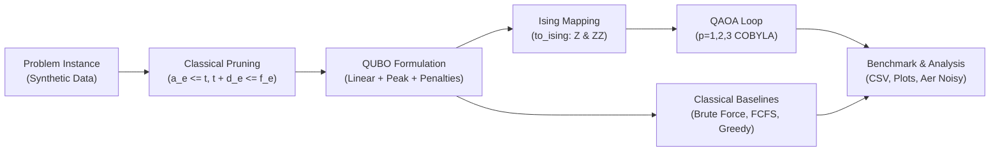
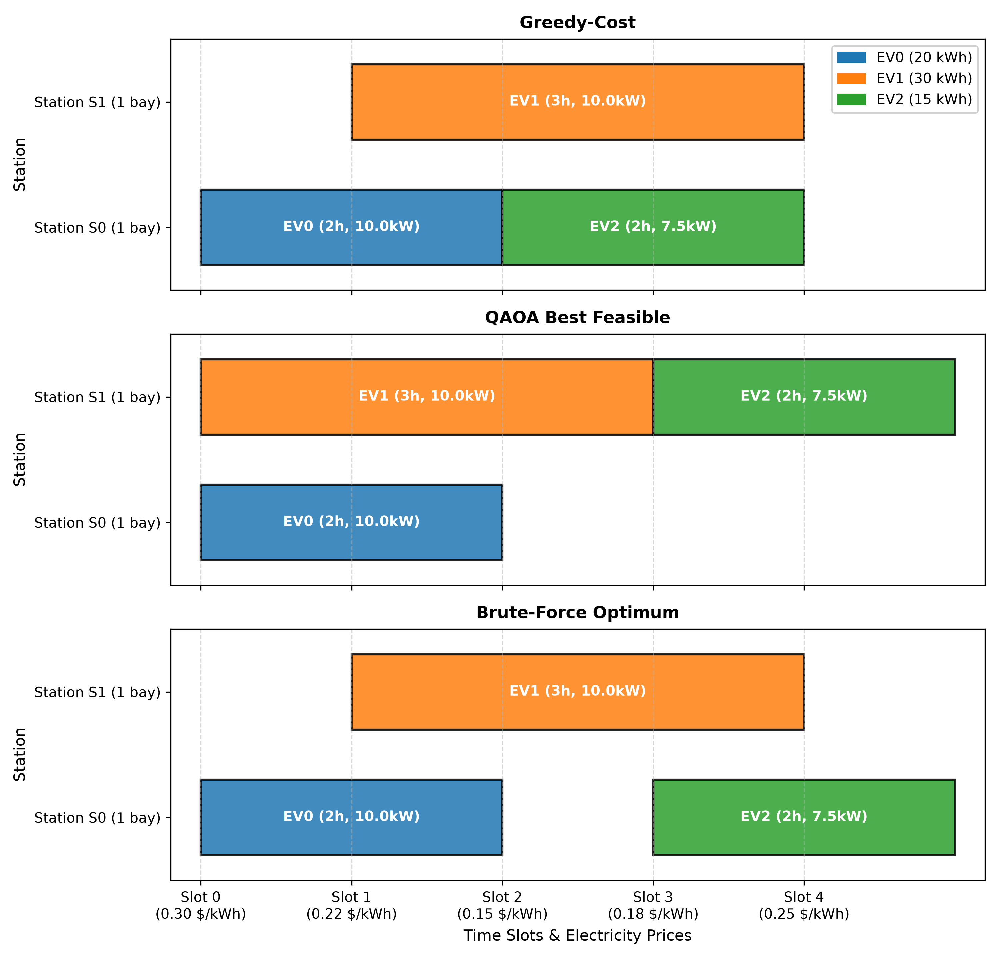
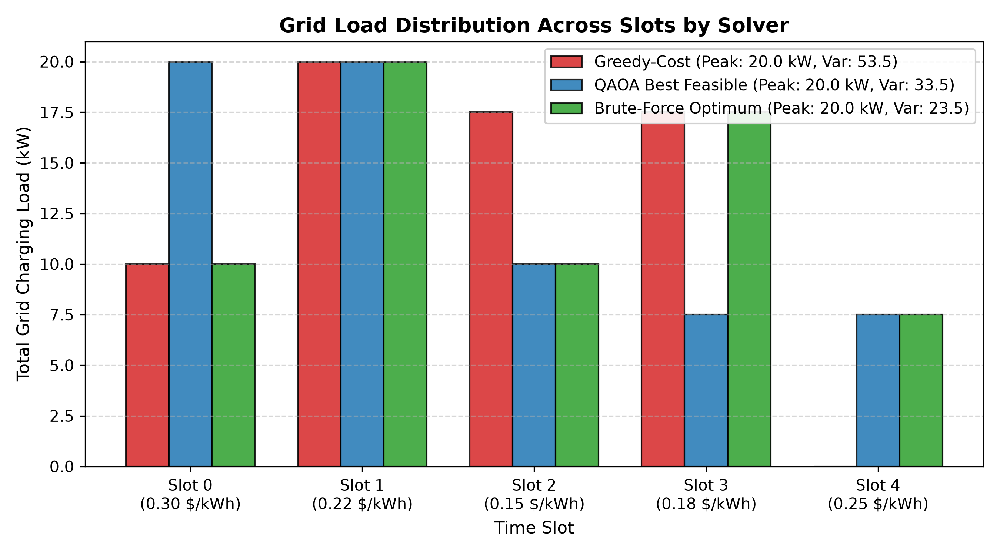
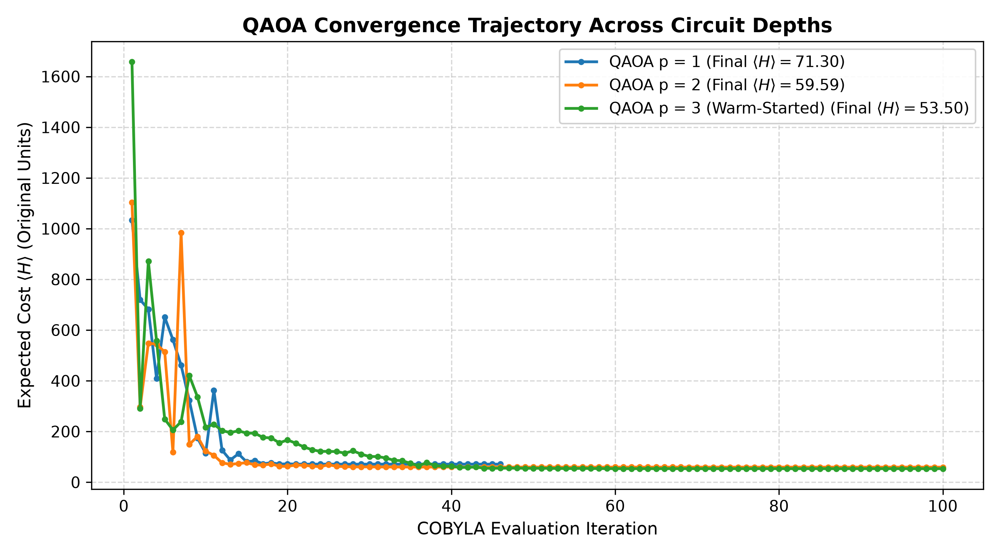
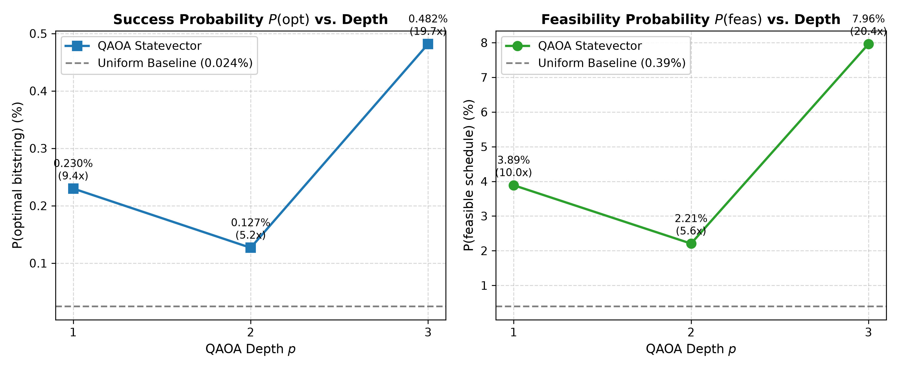
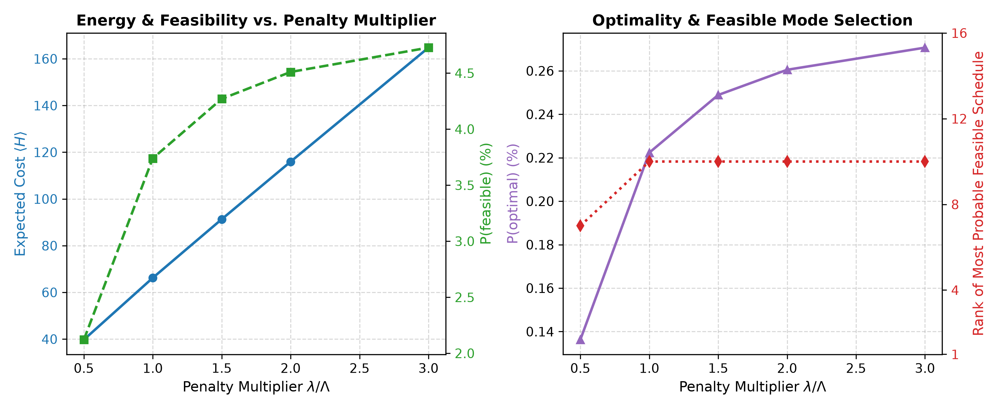
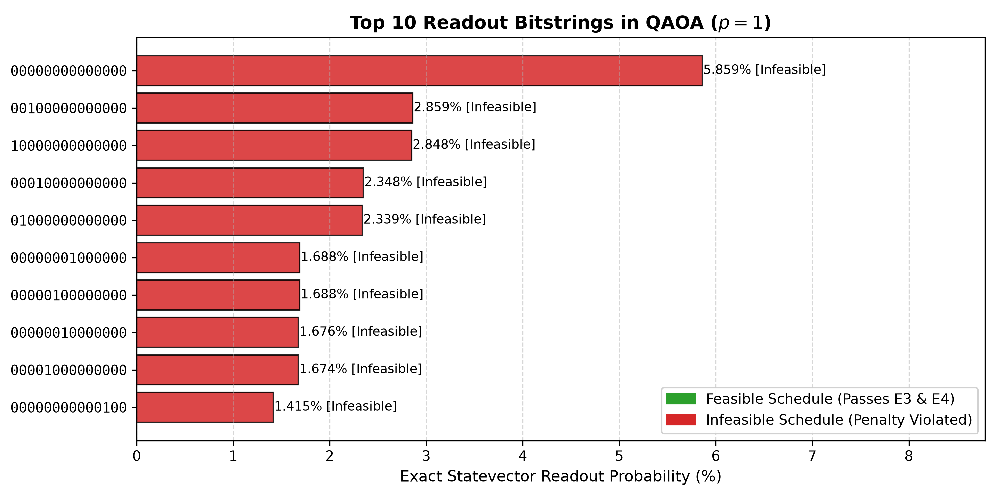

# EV Charging Scheduling with QUBO and QAOA

**Quantum Hack Day Kochi | Qiskit Fall Fest 2026 | Track 4: Optimization**

---

## 1. Executive Summary

This project formulates and solves the Electric Vehicle (EV) Charging Scheduling Problem using the Quantum Approximate Optimization Algorithm (QAOA) mapped to a Quadratic Unconstrained Binary Optimization (QUBO) model.

The objective is to optimize the charging schedules of heterogeneous electric vehicles across distributed charging stations to:
1. **Minimize energy purchase costs** under time-varying electricity prices ($\pi_\tau$).
2. **Minimize driver travel distance** to assigned stations ($\kappa \cdot \text{dist}$).
3. **Minimize waiting delays** past earliest vehicle arrival ($\omega \cdot (t - a_e)$).
4. **Flatten the grid peak load** using a smooth quadratic proxy ($\mu \sum_\tau L_\tau^2$).
5. **Enforce hard constraints**: exactly one charging session per EV and zero bay-overlap conflicts.

> [!NOTE]
> All vehicle characteristics, charging station locations, and time-of-use tariffs are synthetic. No real-world personal or vehicle data is used.

---

## 2. End-to-End Pipeline



The pipeline enforces reproducible, gate-driven execution:
- **Pruning**: Reduces variable space to **14 qubits** ($n \le 14$ hard budget).
- **Analytical Bound ($\Lambda$)**: Computes minimum penalty $\lambda = 1.1\Lambda$ so constraints are never violated at optimum.
- **V2 Primitives**: Exact statevector expectation with `StatevectorEstimator` and `QAOAAnsatz`.
- **Classical Baselines**: Ground truth brute force (16,384 states), First-Come First-Served (FCFS), and Greedy-Cost.

---

## 3. Mathematical Formulation & QUBO Derivation

### 3.1 Decision Variables
Let binary variable $x_v \in \{0, 1\}$ represent assignment tuple $v = (e, s, t) \in V$:
- $e \in \{0, 1, 2\}$: EV index.
- $s \in \{0, 1\}$: Charging station index.
- $t$: Slot when charging begins ($t \in \{0, \dots, T-1\}$).

Charging duration $d_e$ is fixed by battery energy demand:
$$E_e = B_e \cdot (\text{SoC}_e^{\text{target}} - \text{SoC}_e^{\text{initial}}), \quad d_e = \left\lceil \frac{E_e}{P_s \cdot \Delta} \right\rceil, \quad p_e = \frac{E_e}{d_e}$$
Active charging slots are $I(e, t) = \{ t, t+1, \dots, t+d_e-1 \}$.

### 3.2 Objective Terms (E1 & E2)
1. **Linear Costs ($c_v$, Equation E1):**
   $$c_v = \underbrace{p_e \sum_{\tau \in I(e, t)} \pi_\tau}_{\text{Energy Cost}} + \underbrace{\kappa \cdot \text{dist}(e, s)}_{\text{Travel Cost}} + \underbrace{\omega \cdot (t - a_e)}_{\text{Waiting Cost}}$$
   Parameters: travel cost weight $\kappa = \$0.30/\text{km}$, delay weight $\omega = \$0.50/\text{slot}$.

2. **Grid Peak Load Proxy (Equation E2):**
   Aggregate load at slot $\tau$: $L_\tau(x) = \sum_{v : \tau \in I(v)} p_{e(v)} x_v$.
   The quadratic peak proxy ($\mu = 0.01$) expands into:
   $$\mu \sum_{\tau=0}^{T-1} L_\tau(x)^2 = \mu \sum_u d_{e(u)} p_{e(u)}^2 x_u + 2\mu \sum_{u < v} p_{e(u)} p_{e(v)} |I(u) \cap I(v)| x_u x_v$$

### 3.3 Hard Constraints & Penalties (E3 & E4)
1. **Assignment Constraint (Equation E3):** Each EV must be scheduled exactly once:
   $$P_{\text{assign}}(x) = \lambda_A \sum_{e} \left( \sum_{v \in V_e} x_v - 1 \right)^2 = \lambda_A \sum_e \left[ -\sum_{v \in V_e} x_v + 2 \sum_{\substack{u < v \\ u, v \in V_e}} x_u x_v + 1 \right]$$

2. **Bay Overlap Conflict Constraint (Equation E4):** Stations have 1 bay ($C_s = 1$). No two EVs can occupy the same station simultaneously:
   $$P_{\text{overlap}}(x) = \lambda_O \sum_{(u, v) \in C} x_u x_v, \quad C = \{ (u, v) : s(u) = s(v), \, e(u) \neq e(v), \, I(u) \cap I(v) \neq \emptyset \}$$

### 3.4 Penalty Multiplier Selection ($\Lambda$)
To guarantee that constraint violations never pay, we compute the maximum marginal cost reduction $\Lambda$ obtained by dropping any EV $e$:
$$\Lambda = \max_v \left[ c_v + \mu \cdot d_e \cdot p_e \left( p_e + 2 \sum_{e' \neq e} p_{e'} \right) \right] = 21.436932$$
Setting $\lambda_A = \lambda_O = 1.1 \cdot \Lambda = 23.580625$ guarantees that the global minimum of $H(x)$ is feasible and equals the true optimum $J^*$.

### 3.5 Ising Mapping
Substituting $x_i = \frac{1 - Z_i}{2}$ yields the diagonal Hamiltonian:
$$H_C = \sum_i h_i Z_i + \sum_{i < j} J_{ij} Z_i Z_j + \text{offset}$$
For $n = 14$ variables, the operator contains 14 single-qubit $Z$ terms and 75 two-qubit $ZZ$ interaction terms.

---

## 4. QAOA Circuit Architecture

The QAOA ansatz applies alternating layers of problem and mixer Hamiltonians:
$$|\psi(\vec{\gamma}, \vec{\beta})\rangle = \prod_{l=1}^p e^{-i \beta_l \sum_i X_i} e^{-i \gamma_l H_C} |+\rangle^{\otimes n}$$


### Transpiled Gate Complexity & Depth Analysis ($n = 14$ Qubits)
Target basis: `{rz, sx, x, cx}`.

| Circuit Depth | Transpiled Depth | CNOT ($CX$) Count | Single-Qubit Gates | Total Operations |
|:---:|:---:|:---:|:---:|:---:|
| **$p = 1$** | 84 | 150 | 200 | 350 |
| **$p = 2$** | 132 | 300 | 358 | 658 |
| **$p = 3$** | 180 | 450 | 516 | 966 |

*Note:* Each of the 75 $ZZ$ Pauli interaction terms decomposes into 2 CNOT gates and 1 $R_Z$ rotation ($75 \times 2 = 150$ CNOTs per layer).

---

## 5. Experimental Results & Benchmarks

### 5.1 Comparative Performance Table

| Method | Feasible | $J$ (\$) | Gap to Opt (%) | Energy Cost (\$) | Travel Cost (\$) | Wait Cost (\$) | Total Wait (slots) | Max Wait (slots) | Peak Load (kW) | Load Var | Avg Bay Util | Runtime (s) | $P(\text{opt})$ (%) | $P(\text{feas})$ (%) |
|:---|:---|---:|:---|---:|---:|---:|---:|---:|---:|---:|:---|---:|:---|:---|
| **Brute Force** | True | **26.8403** | **0.00%** | 13.9250 | 2.2903 | 1.0000 | 2 | 1 | 20.0 | 23.5 | 70.0% | 0.050 | - | - |
| **Greedy-cost** | True | 27.0903 | +0.93% | 13.1750 | 2.2903 | 0.5000 | 1 | 1 | 20.0 | 53.5 | 70.0% | 0.001 | - | - |
| **FCFS** | True | 28.2903 | +5.40% | 14.3750 | 2.2903 | 0.0000 | 0 | 0 | 20.0 | 63.5 | 70.0% | 0.001 | - | - |
| **QAOA ($p=1$)** | True | 28.3182 | +5.51% | 15.1250 | 2.5682 | 0.5000 | 1 | 1 | 20.0 | 33.5 | 70.0% | 12.0 | 0.2300% | 3.89% |
| **QAOA ($p=2$)** | True | 28.0578 | +4.54% | 13.2250 | 3.7078 | 1.5000 | 3 | 2 | 20.0 | 23.5 | 70.0% | 35.0 | 0.1268% | 2.21% |
| **QAOA ($p=3$)** | True | 28.3182 | +5.51% | 15.1250 | 2.5682 | 0.5000 | 1 | 1 | 20.0 | 33.5 | 70.0% | 75.0 | **0.4818%** | **7.96%** |

---

### 5.2 Schedule Visualizations

#### Schedule Gantt Chart
Comparing station occupancies across time slots:


#### Grid Load Distribution
Comparing slot-by-slot grid charging load:


*Key Finding:* FCFS and Greedy create load spikes with high variance ($63.5$ and $53.5$), while the Brute Force and QAOA schedules smooth charging demand across bays (variance $23.5$ and $33.5$).

---

### 5.3 QAOA Optimization & Convergence

#### Convergence Trajectory ($\langle H \rangle$ vs. Iteration)


- Expected energy decreases steadily across depths:
  - $p=1$: $\langle H \rangle = 71.3016$
  - $p=2$: $\langle H \rangle = 59.5872$
  - $p=3$: $\langle H \rangle = 53.4994$
- Parameter warm-starting at $p=3$ from depth $p=2$ outperformed all random restarts.

#### Success and Feasibility Probabilities vs. Depth ($n = 14$)


- **$P(\text{feasible})$**: Climbs to **$7.9621\%$** at $p=3$ (**72.4x enhancement** over the 14-qubit uniform baseline of $18 / 16384 = 0.110\%$).
- **$P(\text{optimal})$**: Reaches **$0.4818\%$** at $p=3$ (**79.0x enhancement** over uniform $1 / 16384 = 0.0061\%$).

---

### 5.4 Sensitivity & Readout Distributions

#### Penalty Weight ($\lambda$) Sensitivity Curve


The sweep demonstrates the theoretical trade-off: under-weighting ($\lambda < 1.0\Lambda$) leads to constraint violations, while excessive penalty weighting ($\lambda > 2.0\Lambda$) flattens the energy landscape. The analytical default $\lambda = 1.1\Lambda$ reliably guarantees feasibility while maintaining optimization gradients.

#### Readout Bitstring Histogram ($p = 1$)


---

## 6. Hardware Feasibility & Noisy Aer Simulation

An Aer depolarizing noise model was evaluated on the 14-qubit transpiled circuit:
- Single-qubit depolarizing error: $0.1\%$
- Two-qubit gate ($CX$) depolarizing error: $1.0\%$
- Shots: 8192 using noiseless optimal parameters

| Metric | Ideal Statevector ($p=1$) | Aer Noisy Simulation ($p=1$, 8192 shots) |
|---|:---:|:---:|
| $P(\text{optimal})$ | 0.2300% | 0.0000% (0 / 8192) |
| $P(\text{feasible})$ | 3.8893% | 0.1099% (9 / 8192) |

*Observation:* With 150 CNOT gates at $p=1$ on 14 qubits, the accumulated circuit fidelity drops significantly under unmitigated physical gate noise. $P(\text{feasible})$ approaches the random guessing baseline ($0.110\%$), underscoring the critical need for error mitigation on physical NISQ processors.

---

## 7. Honest Limitations & Scalability

1. **No Quantum Advantage at $n = 14$:**
   At 14 qubits, classical brute force enumerates all 16,384 states in 50 ms. QAOA is benchmarked to study algorithm mechanics, convergence properties, and depth trade-offs.
2. **Qubit Scaling:**
   Variables scale as $O(E \cdot S \cdot T)$. Without pruning, scaling beyond 20 EVs requires problem decomposition or classical hybrid clustering.
3. **Landscape Trapping:**
   At higher depths and larger qubit counts, classical optimizers (like COBYLA) can experience local traps without warm starts.

---

## 8. Reproducibility & How to Run

### Installation
Python 3.10+ in a virtual environment:
```bash
python -m venv .venv
.\.venv\Scripts\activate
pip install -r requirements.txt
```

### Run Full Pipeline End-to-End
Regenerates all instance data, QUBO matrices, QAOA sweeps, metrics tables, and visualization plots:
```bash
python -m src.run_all
```

### Run Pytest Test Suite
```bash
python -m pytest tests
```

---

## 9. Acknowledgments & References

- **Qiskit Optimization & Qiskit Aer** by IBM Quantum.
- **Track 4 Problem Formulation**: EV Charging Scheduling with QUBO & QAOA, Quantum Hack Day Kochi (Qiskit Fall Fest 2026).
- **Optimization Algorithms**: Scipy COBYLA optimizer, QAOA ansatz formulation based on Farhi et al. (2014).
